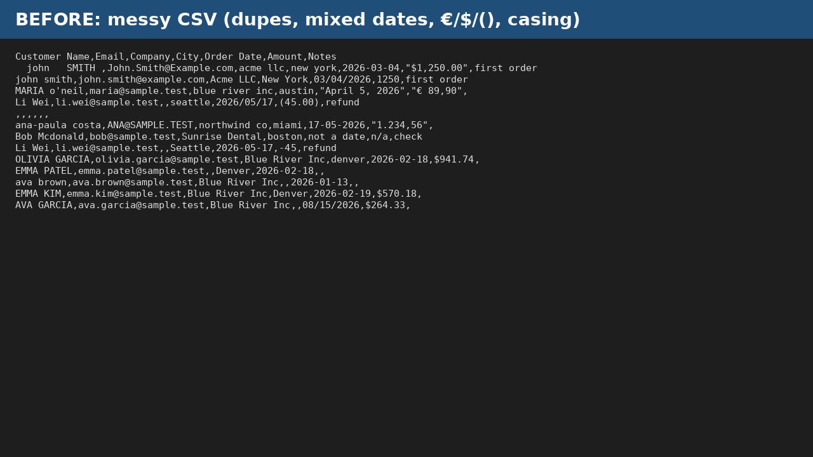

# CSV Data Cleaner (Python): remove duplicates, trim whitespace, report blanks

A tiny, free **Python CSV cleaner**: one command removes exact duplicate rows, trims whitespace, drops empty rows and prints a blanks-per-column report. Handy for cleaning CRM, e-commerce or spreadsheet exports before importing them somewhere else.



## Usage
```bash
pip install -r requirements.txt
python data_cleaner_lite.py sample_messy_customers.csv
# writes sample_messy_customers_clean.csv
```
CSV / UTF-8 input. Requires Python 3.8+ and pandas.

## Want more?
**Data Cleaner Pro** adds name/email casing fixes, dates standardized to YYYY-MM-DD, currency text such as `$1,250.00`, `€ 89,90` or `(45.00)` converted to numbers, key-column dedupe, Excel (.xlsx) input/output, auto encoding and delimiter detection, plus separate blanks, removed-duplicates and parse-issue reports.
[Get Data Cleaner Pro (US$15)](https://payhip.com/b/3awQx) · [Other tools](https://payhip.com/ZeroaCem)

## Notes
Made with AI assistance and tested by running the script on the included sample data. Keep a backup of your original file. Sample data is fictional. MIT licensed (Lite only).
